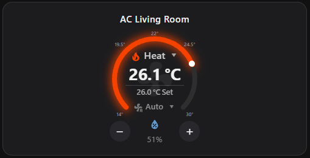

# Mini AC Card for Home Assistant

A compact, touch-friendly climate control with a live temperature gauge—built to be configured in Home Assistant’s visual editor, so you don’t need to write YAML.

## What it can do

- See the current temperature and set temperature at a glance.
- Drag the gauge’s white setpoint dot with a mouse or touchscreen. The preview updates while you drag, and the temperature readout follows the dot around the gauge.
- Set temperature with the `+` and `−` controls or by dragging the gauge.
- Choose HVAC mode and fan speed from dropdowns.
- See humidity, with an optional separate humidity sensor.
- Use an optional separate temperature sensor; when none is selected, the card reads the climate entity’s current temperature.
- Read four small temperature markers around the sides of the gauge, plus a subtle center-top reference marker.
- Tune the radiant gauge glow, center fan watermark visibility, opacity, size, and spin speed.
- Adjust overall sizing, temperature text sizes, dropdown width, and element spacing to suit your dashboard.
- Use the same responsive layout on desktop and mobile, with touch dragging that avoids scrolling the dashboard.

## Install with HACS (recommended)

HACS must already be installed in Home Assistant.

1. Open **HACS → Frontend**, open the menu in the upper-right, and choose **Custom repositories**.
2. Add this repository’s GitHub URL and select **Dashboard** as the category.
3. Find **Mini AC Card** in HACS and choose **Download**.
4. Refresh the browser (or the Home Assistant app), then open a dashboard and choose **Edit dashboard → Add card → AC Gauge Card**.
5. Select your climate entity and configure the card in the visual editor.

No YAML is needed. If the card does not appear after refreshing, confirm the repository was added with the **Dashboard** category and reload the frontend.

## Manual install without YAML

1. Download `ac-gauge-card.js` from this repository.
2. In Home Assistant, open **Settings → Dashboards → Resources** and add `/local/ac-gauge-card.js` as a JavaScript module. If you store the file in a subfolder under `www`, use that matching `/local/...` path.
3. Open a dashboard, choose **Edit dashboard → Add card**, and select **AC Gauge Card**.
4. Pick the climate entity and tune the appearance and behavior in the visual editor.

The card’s editor stores its configuration for you. No manual YAML is needed.

## Credits

Created by **ChatGPT Luna** from the project owner’s ideas and feedback. The card’s code was generated by ChatGPT Luna; no human hand-wrote the code.

